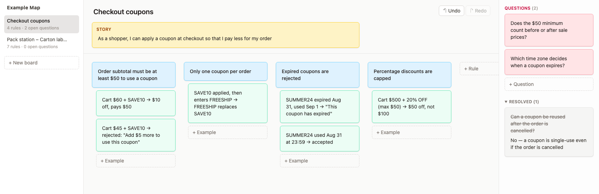

English | [繁體中文](README.zh-TW.md)

# Example Map

A local [Example Mapping](https://cucumber.io/blog/bdd/example-mapping-introduction/) board that AI agents can drive through **MCP**.

Ask your AI agent (Claude Code, Cursor, or any MCP client) to act as an Example Mapping facilitator. It builds the
Story, Rules, Examples and Questions on a shared board while you watch in the browser. You can edit and drag cards
yourself too, and the AI sees your changes on its next turn.

<!-- Screenshot: add a board screenshot or GIF here, e.g.  -->

## Features

- **Classic four-color cards**: yellow Story, blue Rules, green Examples, red Questions
- **Real-time sync**: AI changes show up in the browser instantly over WebSocket, and cards the AI just touched glow purple for about 2 seconds
- **Human + AI on one board**: inline editing, drag-and-drop to reorder rules or move examples between rules
- **Shared undo/redo**: one history for you and the AI, one step per action. You can also ask the AI to "undo that last step"
- **Board health hints**: `get_board` flags things like rules without examples or too many open questions, so the AI can prompt you
- **Markdown export** of any board
- **Local-first**: runs on your machine and stores boards as JSON files

## Quick start

Requires Node.js 22+ and pnpm 10+.

```bash
git clone https://github.com/levijcl/Example-mapping-tool-for-AI.git
cd Example-mapping-tool-for-AI
pnpm install
pnpm start
```

Open <http://127.0.0.1:4319> in your browser.

## Connect your AI agent

The server exposes MCP over **Streamable HTTP** at `http://127.0.0.1:4319/mcp`.

**Claude Code**

```bash
claude mcp add --transport http example-map http://127.0.0.1:4319/mcp
```

**Cursor** (`.cursor/mcp.json`)

```json
{
  "mcpServers": {
    "example-map": { "url": "http://127.0.0.1:4319/mcp" }
  }
}
```

**Other MCP clients**: add a Streamable HTTP server with the URL above.

## Usage

Tell your agent something like:

> Let's do example mapping for: "As a shopper, I can apply a coupon at checkout"

Or use the built-in MCP prompt `facilitate-example-mapping` (in Claude Code:
`/mcp__example-map__facilitate-example-mapping`).

The AI creates a board, proposes rules with concrete examples, and records anything uncertain as questions. You can then:

- Click any text to edit it (Enter saves, Shift+Enter adds a new line, Esc cancels)
- Drag rule columns to reorder them, or drag an example onto another rule
- Undo/redo with the toolbar buttons or Cmd/Ctrl+Z and Cmd/Ctrl+Shift+Z
- Resolve a question with an answer, then ask the AI to "update the rules based on the answers"

AI actions apply to **the board currently open in the browser** by default.

## MCP tools

| Category  | Tools                                                                                       |
| --------- | ------------------------------------------------------------------------------------------- |
| Board     | `list_boards`, `create_board`, `open_board`, `get_board`, `export_markdown`                 |
| Story     | `set_title`, `set_story`                                                                    |
| Rules     | `add_rule` (can include examples), `update_rule`, `delete_rule`, `move_rule`                |
| Examples  | `add_example`, `update_example`, `delete_example`, `move_example`                           |
| Questions | `add_question`, `update_question`, `resolve_question`, `reopen_question`, `delete_question` |
| History   | `undo`, `redo`                                                                              |

**Prompt:** `facilitate-example-mapping`

Deleting a whole board is only possible from the UI.

## Configuration

| Variable   | Default         | Description                      |
| ---------- | --------------- | -------------------------------- |
| `PORT`     | `4319`          | HTTP / WebSocket / MCP port      |
| `DATA_DIR` | `<repo>/boards` | Where board JSON files are saved |

Every change is written to `DATA_DIR` immediately. Undo history is kept in memory only and is cleared on restart.

## Security

The server binds to `127.0.0.1` only and rejects HTTP and WebSocket requests whose Host or Origin is not localhost.
This stops malicious web pages from reaching your board through your browser (DNS rebinding, cross-site WebSocket).

## Development

```bash
pnpm dev          # server (watch, :4319) + Vite dev server (proxies /api /ws /mcp)
pnpm test         # Vitest: shared / server / web
pnpm test:e2e     # Playwright (run `pnpm exec playwright install chromium` first)
pnpm typecheck
pnpm lint
```

```
packages/
  shared/   data model (zod), applyCommand, board health analysis, Markdown export, WS protocol
  server/   BoardStore (JSON persistence), REST + WebSocket, MCP server
  web/      React + Tailwind + dnd-kit board UI
e2e/        Playwright: AI ↔ browser sync, manual editing, drag-and-drop, undo/redo (Screenplay pattern)
docs/       spec and implementation plan
```

See [docs/spec.md](docs/spec.md) for the design. The E2E architecture is documented in
[README.zh-TW.md](README.zh-TW.md#e2e-測試架構).
